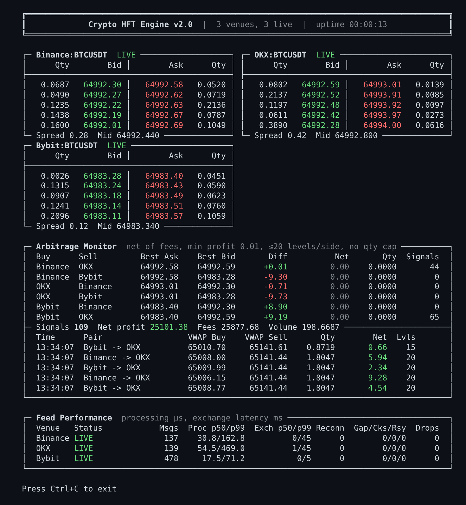
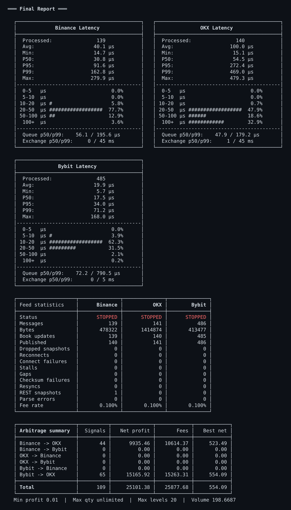
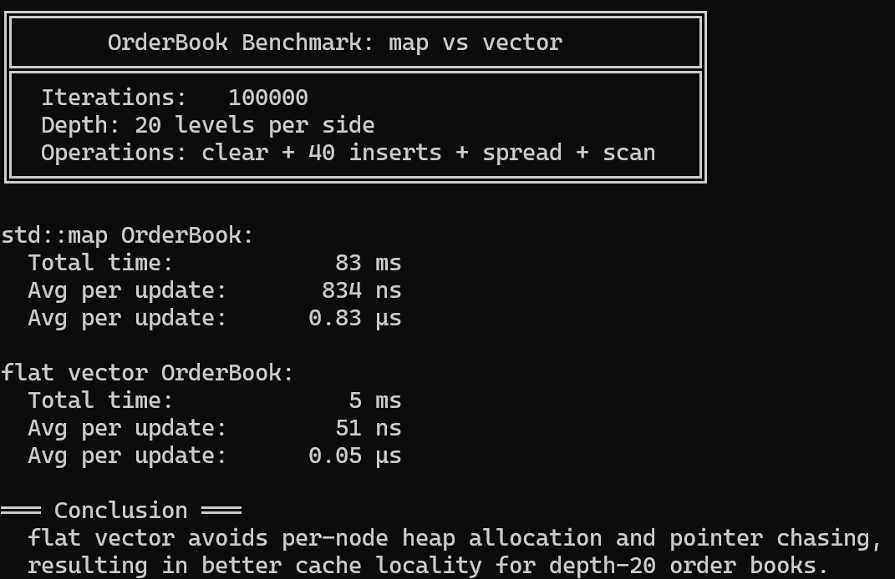

# Crypto HFT Engine

A low-latency, cross-exchange cryptocurrency arbitrage monitoring system built in C++17. Connects to multiple exchanges via WebSocket, maintains real-time order books, and detects arbitrage opportunities across exchanges.

## Screenshot

### Live Dashboard


### Final Report


### Orderbook Benchmark


## Architecture

```
                    ┌──────────────────────────────────────┐
                    │             Main Thread              │
                    │  Display + Arbitrage Detection Loop  │
                    └──────────┬───────────┬───────────────┘
                               │           │
                    ┌──────────▼──┐  ┌─────▼─────────┐
                    │   Thread 1  │  │    Thread 2   │
                    │  Binance WS │  │     OKX WS    │
                    └──────┬──────┘  └──────┬────────┘
                           │                │
                    ┌──────▼──────┐  ┌──────▼─────────┐
                    │  OrderBook  │  │   OrderBook    │
                    │  (Binance)  │  │     (OKX)      │
                    └──────┬──────┘  └──────┬─────────┘
                           │                │
                    ┌──────▼────────────────▼──────────┐
                    │      ArbitrageDetector           │
                    │  Cross-exchange spread analysis  │
                    │  Fee-adjusted profit calculation │
                    └──────────────────────────────────┘
```

## Features

- **Real-time dual exchange data**: Simultaneous WebSocket connections to Binance and OKX
- **Multi-threaded architecture**: Each exchange runs on an independent thread with a mutex-protected order book
- **Order book maintenance**: Cache-friendly flat vector order book with 18x faster updates than std::map
- **Cross-exchange arbitrage detection**: Bi-directional spread monitoring with configurable fee rates and signal deduplication
- **Low-latency JSON parsing**: Uses simdjson with allocation-free `std::from_chars` number parsing for microsecond-level message processing (see [Performance](#performance))
- **Live terminal dashboard**: Side-by-side order books, a green/red cross-exchange spread monitor, and a running signal count
- **Latency profiling**: p50/p95/p99 latency tracking with histogram visualization
- **Signal logging**: File-based logging with timestamps for spread snapshots and arbitrage signals
- **JSON configuration**: Trading pairs, fee rates, and display settings configurable via config.json

## Tech Stack

| Component | Technology |
|-----------|-----------|
| Language | C++17 |
| Build System | CMake |
| WebSocket | Boost.Beast |
| SSL/TLS | OpenSSL |
| JSON Parser | simdjson |
| Threading | std::thread + std::mutex |
| Timing | std::chrono (high_resolution_clock) |

## Project Structure

```
Crypto_HFT_Engine/
├── CMakeLists.txt
├── config.json                       # Runtime configuration
├── Setup.sh                          # Installs dependencies, downloads simdjson
├── include/
│   ├── orderbook.h                   # Flat vector order book
│   ├── market_data_feed.h            # WebSocket connection + JSON parsing
│   ├── arbitrage_detector.h          # Cross-exchange spread detection
│   ├── latency_tracker.h             # p50/p95/p99 latency profiling
│   ├── display.h                     # Terminal UI rendering
│   ├── logger.h                      # File-based signal/spread logging
│   └── config.h                      # JSON config reader
├── src/
│   └── main.cpp                      # Entry point, thread management, main loop
├── benchmark/
│   ├── orderbook_benchmark.cpp       # map vs vector performance comparison
│   └── parse_benchmark.cpp           # std::stod vs std::from_chars comparison
├── docs/
│   ├── screenshot_dashboard.png
│   ├── screenshot_report.png
│   └── screenshot_benchmark.png
└── third_party/                      # Downloaded by Setup.sh (gitignored)
    ├── simdjson.h
    └── simdjson.cpp
```

## How It Works

1. **Configuration**: On startup, reads config.json from the current directory for exchange endpoints, fee rates, and display settings. If the file is missing, is not valid JSON, or has any field missing or of the wrong type, the whole file is ignored and the built-in defaults in `include/config.h` are used. They match the shipped file except `fee_rate`, which defaults to 0.001.

2. **Market Data Ingestion**: Two independent threads connect to Binance and OKX WebSocket APIs, receiving order book snapshots (each one replaces the local book; no incremental diffs): 20 levels every 100ms from Binance (`depth20@100ms` stream) and 5 levels from OKX (`books5` channel).

3. **Order Book Update**: Each snapshot is parsed using simdjson (prices and quantities via `std::from_chars`) and written into a flat vector order book. Bids are stored high-to-low, asks low-to-high, matching exchange sort order, so levels are appended as they arrive with no sorting.

4. **Arbitrage Detection**: On every dashboard refresh (`refresh_ms`, 200ms by default), the main thread copies both order books and checks both directions: buy at one exchange's best ask, sell at the other's best bid. Detection therefore runs at the refresh rate, not on every book update. Net profit is the price gap times the smaller of the two best-level quantities, minus `fee_rate` on each side. A signal is generated only when net profit exceeds `min_profit` (0.01 in the shipped config) and the buy or sell price has moved by at least 0.01 (a fixed threshold) since that direction's last signal (deduplication). The shipped config.json sets `fee_rate` to 0.0, so no fees are deducted; set it to 0.001 for 0.1% per side, the built-in default.

5. **Logging**: All signals are written to timestamped log files. Spread snapshots are recorded every `spread_log_interval` refreshes (50 × 200ms ≈ 10 seconds with the shipped config) for post-session analysis.

6. **Display**: All data is rendered to the terminal in a dashboard layout with ANSI color coding.

7. **Feed Status**: Each feed shows `[LIVE]` while its receive thread is running and `[DOWN]` once a connection error or close ends that thread. Reads have no timeout, so a connection that goes silent without an error stays `[LIVE]` with a frozen book; only its message count stops rising. Feeds do not reconnect: a stalled or `[DOWN]` feed keeps its last order book, which is still used for signals and spread logs, so restart the program if a feed goes down. On Ctrl+C the program waits for each feed's next message before exiting, so a stalled feed can also block shutdown. Connection errors go to stderr only, not to the log file, and the dashboard redraws the whole screen on every refresh; run `mkdir -p logs && ./build/crypto_hft_engine 2>>logs/stderr.log` to keep them.

## Quick Start

### Prerequisites
- Ubuntu 22.04+ or WSL2
- g++ 11+ (C++17, including floating-point `std::from_chars`)
- CMake 3.16+
- curl (Setup.sh uses it to download simdjson but does not install it)

### Build & Run

```bash
# Install dependencies (also downloads simdjson into third_party/, which the build needs)
bash Setup.sh

# Build
mkdir build && cd build
cmake ..
make

# Run (from project root, so config.json and logs/ are in the right place)
cd ..
./build/crypto_hft_engine
```

### Configuration

Edit the values in `config.json` to change trading pairs, fee rates, or display settings. Keep every key and its JSON type (`port` and `subscribe` are strings; `refresh_ms`, `levels` and `spread_log_interval` are integers). If anything is missing or mistyped, the whole file is ignored and the built-in defaults are used, with only a `[Config] ... using defaults` line on stderr.

| Key | Meaning |
|-----|---------|
| `host`, `port`, `okx.path` | WebSocket endpoint for each exchange |
| `binance.path` | Binance stream; selects the Binance market (e.g. `/ws/btcusdt@depth20@100ms`) |
| `okx.subscribe` | OKX subscribe message; its `instId` selects the OKX market (e.g. `BTC-USDT`) |
| `binance.symbol`, `okx.symbol` | Display labels only |
| `arbitrage.fee_rate` | Fee per side as a fraction (`0.001` = 0.1%); the shipped file uses `0.0` |
| `arbitrage.min_profit` | Minimum net profit per signal, in the quote currency (USDT for the shipped pair) |
| `display.refresh_ms` | Dashboard refresh interval, which is also how often arbitrage is checked |
| `display.levels` | Price levels shown per book (OKX `books5` provides at most 5) |
| `display.spread_log_interval` | Log a spread snapshot every N refreshes (must be at least 1) |
| `enabled` | Required, but currently ignored: both feeds always start |

To switch to ETH/USDT, change the market on both exchanges and leave the other keys as they are:

```json
"binance": { "enabled": true, "host": "stream.binance.com", "port": "9443",
             "path": "/ws/ethusdt@depth20@100ms", "symbol": "ETHUSDT" },
"okx": { "enabled": true, "host": "ws.okx.com", "port": "8443", "path": "/ws/v5/public",
         "symbol": "ETHUSDT",
         "subscribe": "{\"op\":\"subscribe\",\"args\":[{\"channel\":\"books5\",\"instId\":\"ETH-USDT\"}]}" },
```

## Performance

| Metric | Value |
|--------|-------|
| Order book update (std::map) | 862 ns |
| Order book update (flat vector) | 48 ns |
| **Improvement** | **18x** |
| Binance parse latency (p50, 20 levels) | ~15 us |
| OKX parse latency (p50, 5 levels) | ~8 us |
| Parse latency (p99) | < 100 us |
| Best bid/ask query | O(1) array index |
| Memory footprint | ~10 MB RSS in a 20 s run; grows slowly because every signal is kept in memory |

The order book figures come from the benchmark run in commit a1d9928. The screenshot above is a later run (834 ns vs 51 ns, ~16x), and results vary by machine. Parse latency is measured per message, from the end of the WebSocket read to the order book update, so network time is not included. The parse latency figures were measured with `std::stod`, before the switch to `std::from_chars` in commit c874f19.

### Benchmark

```bash
# Build and run the order book benchmark (std::map vs flat vector)
g++ -std=c++17 -O2 -o benchmark/orderbook_bench benchmark/orderbook_benchmark.cpp
./benchmark/orderbook_bench

# Build and run the parse benchmark (std::stod vs std::from_chars)
g++ -std=c++17 -O2 -o benchmark/parse_bench benchmark/parse_benchmark.cpp
./benchmark/parse_bench
```

## Design Decisions

**Why flat vector instead of std::map for the order book?**
The initial implementation used `std::map` (red-black tree) for automatic sorting. Every snapshot rebuild paid for one heap allocation per price level, plus tree rebalancing and pointer chasing. Since exchange depth snapshots arrive pre-sorted, a flat `std::vector<PriceLevel>` with direct append achieves the same result with zero heap allocation and contiguous, cache-friendly storage. Benchmarking showed an **18x improvement** (862ns to 48ns per update) over 100K iterations.

**Why synchronous WebSocket reads?**
Each exchange connection is isolated in its own thread with blocking reads. The bottleneck is network I/O (milliseconds), not thread synchronization (nanoseconds), so async I/O would add complexity without meaningful latency improvement.

**Why std::mutex instead of lock-free?**
Mutex contention is negligible compared to network latency. Premature lock-free optimization would increase code complexity and bug surface without measurable benefit at current throughput levels.

**Why signal deduplication?**
Without deduplication, the same arbitrage opportunity triggers repeatedly every 200ms while the price remains unchanged. Each direction tracks its last buy/sell price independently and only fires when the buy or sell price has moved by at least 0.01 (a fixed threshold in `arbitrage_detector.h`).

## Roadmap

- [x] Dual exchange WebSocket data (Binance + OKX)
- [x] Cross-exchange arbitrage detection
- [x] Latency histogram (p50/p95/p99)
- [x] Signal logging to file
- [x] Flat vector order book optimization (18x faster)
- [x] JSON configuration
- [ ] Add Bybit exchange support
- [ ] Lock-free SPSC queue for order book updates
- [ ] Custom memory pool allocator
- [ ] SIMD-optimized price comparison

## License

MIT License - see [LICENSE](LICENSE) for details.